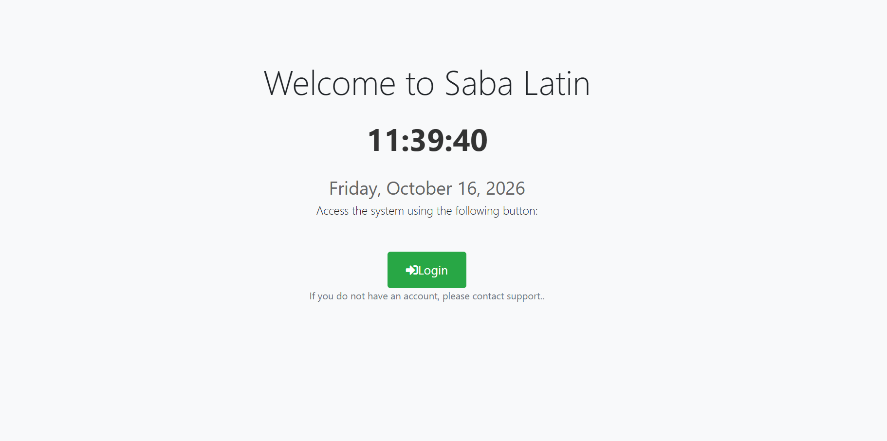
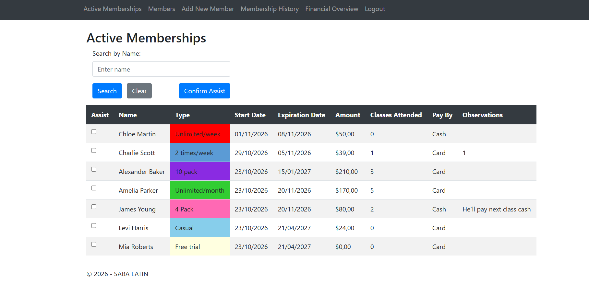
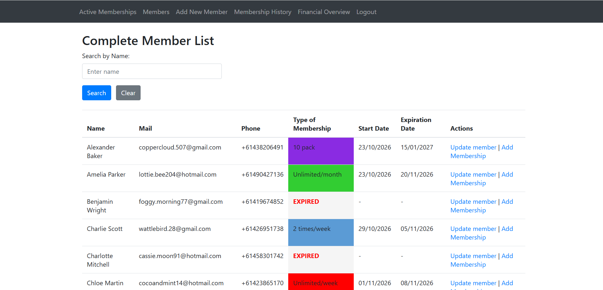
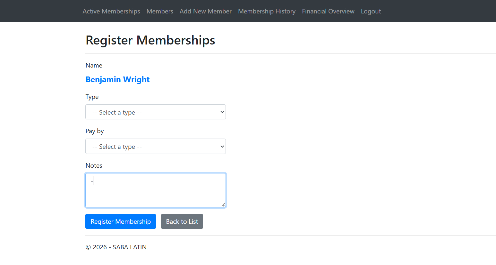
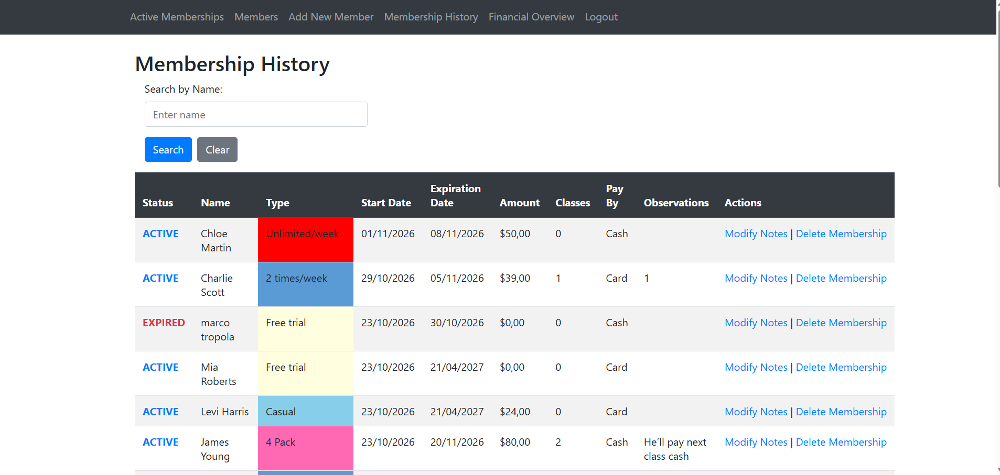
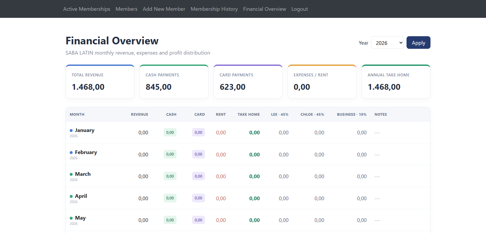

## Saba Latin – Membership Management

Saba Latin is a membership and financial management system developed for a salsa dance school. It centralizes member registration, membership lifecycle management, class attendance tracking and monthly financial reporting.

The application automates key business rules, including membership expiration, attendance limits, payment tracking and revenue calculations, reducing manual administrative work and improving data consistency.

Built with **ASP.NET MVC 5 (C#)**, **ADO.NET** and **SQL Server**.

## Features

### Members
- Register members (name, phone, e-mail) with form validation.
- Every new member automatically gets a **7-day free trial** membership.
- Member list with the current membership type and dates, searchable by name.
- Edit member details.

### Memberships
- 8 membership types (see the table below).
- Add a membership to a member: choose the type, the payment method (cash or card) and optional notes. The price and the expiration date are set from the chosen type.
- A member can only have **one active membership** at a time.
- **Attendance:** tick the members in the active memberships list and confirm. Each confirmation adds one class to the membership, and a membership with a class limit closes automatically when the limit is reached.
- Expired memberships are deactivated automatically when the active memberships list is loaded.
- Full membership history, searchable by name, with editable notes and the option to delete a membership.
-

| Type            | Duration | Classes   | Price |
|-----------------|----------|-----------|-------|
| Week Intro      | 7 days   | 1         | $10   |
| Unlimited/week  | 7 days   | Unlimited | $50   |
| Casual          | 180 days | 1         | $24   |
| 2 times/week    | 7 days   | 2         | $39   |
| Free trial      | 7 days   | 1         | $0    |
| 10 pack         | 84 days  | 10        | $210  |
| Unlimited/month | 28 days  | Unlimited | $170  |
| 4 Pack          | 28 days  | 4         | $80   |

### Financial overview
- Monthly report for the selected year with annual totals.
- Revenue is counted in the month the membership started, split into **cash** and **card**.
- Monthly rent and notes are read from the `FinanzasMensuales` table.
- **Take home** = revenue − rent, distributed as 45% / 45% / 10% (Lee, Chloe and the business).

### Security
- Employee login. Passwords are stored as salted PBKDF2 hashes (10,000 iterations, random 16-byte salt), never in plain text.
- Every page except the home page and the login requires an active employee session.
- Every POST action is protected with anti-forgery tokens.
- All database access goes through stored procedures, and values are always sent as parameters. There is no inline SQL.

## Application Architecture

The application follows a layered architecture, separating the user interface, business logic, data access, and database operations.

### 1. Presentation Layer
**ASP.NET MVC 5 · Razor Views · Bootstrap**

Responsible for displaying information to the user and collecting input through forms. Razor Views render the data received from the controllers and send user actions through HTTP requests.

### 2. Controller Layer
**HTTP Requests · Validation · Session Management**

Controllers handle incoming requests, validate user input, manage employee sessions, and coordinate application operations. They call the persistence layer to retrieve or modify data and return the appropriate view to the user.

### 3. Persistence Layer
**ADO.NET · SqlConnection · SqlCommand · SqlDataReader**

Responsible for communication between the application and the database. It opens SQL connections, executes stored procedures using parameters, and maps the returned data into C# objects.

### 4. Database Layer
**SQL Server · Relational Tables · Stored Procedures**

Stores the application's data and handles database operations. Stored procedures implement important database rules, such as registering memberships, updating class attendance, checking expiration dates, and retrieving financial information.

### Communication Flow

The layers communicate in the following order:

1. The user interacts with a Razor View.
2. The View sends an HTTP request to the corresponding Controller.
3. The Controller calls a method in the Persistence Layer.
4. The Persistence Layer executes a stored procedure in SQL Server.
5. SQL Server returns the results to the Persistence Layer.
6. The data is passed back through the Controller and displayed in the View.
## Database

## Business Logic and Stored Procedures

An important part of Saba Latin is the implementation of business rules directly through SQL Server stored procedures. These procedures help maintain data consistency and automate membership and attendance operations.

### 1. Membership Registration

The `AltaMembresia` stored procedure handles the registration of new memberships and applies the following business rules:

- Verifies that the member exists.
- Verifies that the selected membership type exists.
- Prevents a member from having more than one active membership at the same time.
- Validates the payment method (Cash or Card).
- Retrieves the membership price and duration from the `TipoMembresia` table.
- Automatically calculates the start and expiration dates.
- Initializes the attended classes counter at zero.
- Stores the membership price at the time of registration.

### 2. Attendance and Membership Control

The `actualizarMembresia` stored procedure manages class attendance and membership limits.

- Registers each attendance.
- Increments the number of attended classes.
- Checks the maximum number of classes allowed by the membership type.
- Automatically deactivates limited memberships when the maximum number of classes is reached.
- Keeps unlimited memberships active, provided they have not expired.

### 3. Automatic Membership Expiration

The `actualizarvencidas` stored procedure checks active memberships against their expiration dates.

- Identifies active memberships whose expiration date has passed.
- Automatically deactivates expired memberships.
- Runs when the application requests the list of active members.

### 4. Additional Business Operations

Other stored procedures support the application's daily operations:

- **Member management:** Registration, modification, searching, and listing members.
- **Membership management:** Searching, retrieving membership history, editing notes, and deleting memberships.
- **Financial reporting:** Retrieving monthly financial records, including rent and additional financial information.

By moving these operations into stored procedures, the application centralizes important database operations and reduces the amount of SQL logic handled directly by the C# application.

Database name: `ClasesDeSalsa`

**Tables:** `Empleado`, `Miembro`, `TipoMembresia`, `Membresia`, `FinanzasMensuales`

**Stored procedures:**
- Login: `logueo`
- Members: `AltaMiembro`, `BuscarMiembro`, `modificarMiembro`, `ListarMiembros`
- Memberships: `AltaMembresia`, `BuscarMembresia`, `ListarMiembrosActivos`, `Historial`, `actualizarMembresia`, `actualizarvencidas`, `ModificarNotas`, `Eliminarmembresia`
- Finances: `listarfinanzasmensuales`

## Getting started

**Requirements:** Visual Studio with the ASP.NET workload, and SQL Server.

1. Run `ClaseSalsa.sql` in SQL Server Management Studio. It creates the database, the tables, the membership types, the stored procedures, an employee account and 30 sample members. The script does not drop an existing database, so run it only once (or drop `ClasesDeSalsa` first).
2. Add the connection string to the project's `Web.config`. The name must be `ClasesDeSalsa`. This is an example for a local SQL Server with Windows authentication. For SQL Server Express use `.\SQLEXPRESS` as the data source.

   ```xml
   <connectionStrings>
     <add name="ClasesDeSalsa"
          connectionString="Data Source=.;Initial Catalog=ClasesDeSalsa;Integrated Security=True"
          providerName="System.Data.SqlClient" />
   </connectionStrings>
   ```

3. Open the solution in Visual Studio, restore the NuGet packages and run the project.
4. Sign in with the employee account created by the script (username `Saba`).

The monthly rent has no screen yet. To see it in the financial overview, add a row to the `FinanzasMensuales` table.


## Possible improvements

- A screen to manage the monthly rent.
- Load the membership types from the database instead of listing them in the form.
- Soft delete for memberships, so deleting one does not change past revenue.

## Tech stack

ASP.NET MVC 5 · C# · ADO.NET · SQL Server · Razor · Bootstrap 4 · Font Awesome · jQuery

## Screenshots

### Welcome Screen


### Active Membership list


### Member List


### Register Membership


### Membership History


### Financial Overview
